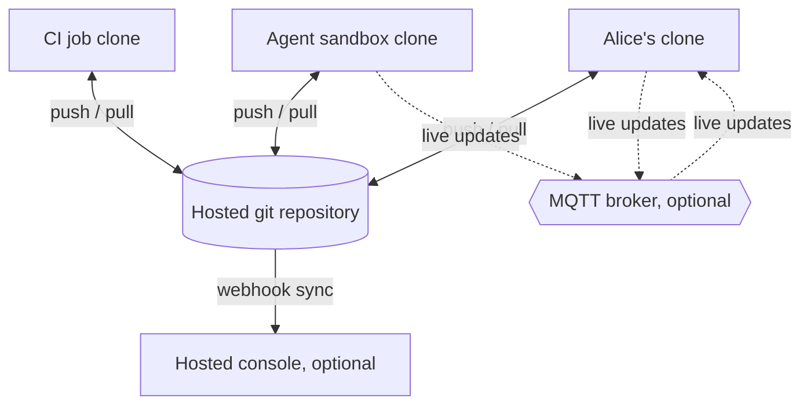

# Files in the cloud

In this setup the board lives in a hosted git repository. Everyone who works on it, whether a person on a laptop, an agent in a cloud coding sandbox, or a CI job, has a clone and uses the same `kbs` commands as in the [local files](local-files.md) guide. Git carries changes between clones. Two optional layers make it feel live: an MQTT broker that announces each change the moment it happens, and a hosted console that serves the repository's board in a browser.



Complete the [local files](local-files.md) guide first, at least through step 4.

## 1. Put the board in the hosted repository

Push the repository that holds `.kanbus.yml` and `project/` to GitHub, GitLab, or any git host:

```bash
git remote add origin git@github.com:acme/website.git
git push -u origin main
```

Before you push, check that the project key in `.kanbus.yml` is unique to this repository. Live updates are routed by project key, so two repositories that share a key will see each other's changes on a shared broker, and their issues can mix in the hosted console.

## 2. Join from another clone

On another machine, in a cloud sandbox, or in CI:

```bash
git clone git@github.com:acme/website.git
cd website
kbs setup env KANBUS_USER --value bob@example.com
kbs list
```

The clone needs only a Kanbus CLI. Agents in sandboxes should set `KANBUS_USER` (or pass `--agent-name` and the other agent flags) so their changes are attributed.

## 3. Sync with the team

Each issue is its own file, so new issues created in different clones never conflict. The loop is:

```bash
git pull                    # pick up everyone else's changes
kbs update acme-aeec87 --status in_progress
kbs commit                  # commit project/issues
git push
```

Pull before you start a change and push soon after. Agents should run `kbs commit` and push at the end of every task; a board that only changes in one clone is invisible to everyone else.

### When two people change the same issue

If two clones change the same issue between pushes, `git pull` reports a conflict in that issue's JSON file. Do not edit the JSON by hand. Keep the version that is already pushed, then repeat your own change with `kbs`:

```bash
git checkout --theirs project/issues/acme-aeec8766-f620-4669-8dc8-c0dd8e4c821c.json
git add project/issues/acme-aeec8766-f620-4669-8dc8-c0dd8e4c821c.json
git commit -m "Merge board: keep the pushed version of acme-aeec87"
kbs comment acme-aeec87 "The note I added before the conflict."
kbs commit
git push
kbs validate                # confirms every issue file parses
```

Until the merge is resolved, `kbs validate` reports the conflicted file as invalid JSON.

For work that several agents might pick up at once, use the coordination commands (`kbs coordination --help`) so only one claims an issue. See [Configuration](../CONFIGURATION.md) for the `coordination` settings.

## 4. Optional: live updates over MQTT

Git moves changes when someone pushes. With a shared MQTT broker, every `kbs` change is also announced immediately, and other clones show it before they pull. Your files stay the source of truth; the broker only carries notifications.

Point every clone at the same broker. In `.kanbus.yml`, so it is committed for everyone:

```yaml
realtime:
  transport: mqtt
  broker: mqtt://broker.example.com:1883
  autostart: false
```

Or per machine, without changing the repository:

```bash
export KANBUS_REALTIME_TRANSPORT=mqtt
export KANBUS_REALTIME_BROKER=mqtt://broker.example.com:1883
```

Any MQTT 3.1.1 broker works, such as Mosquitto on a small server. On a single machine, the default `transport: auto` with `broker: auto` starts a local Mosquitto for you if it is installed, which is enough to try this out.

Check it: in one clone run

```bash
kbs gossip watch --print
```

and in another run `kbs create "Hello from the other clone"`. The watcher prints an `issue.mutated` event right away, and `kbs list` in the first clone shows the new issue before any `git pull`. That comes from the overlay cache in `project/.overlay/`, which is why it is gitignored. `kbs overlay reconcile --all --prune` clears entries that git has caught up with.

## Next

- Tune live updates and the overlay cache: [Realtime collaboration](../REALTIME.md).
- Serve a board to people who do not use git: [S3 and DynamoDB in the cloud](cloud-database.md).
